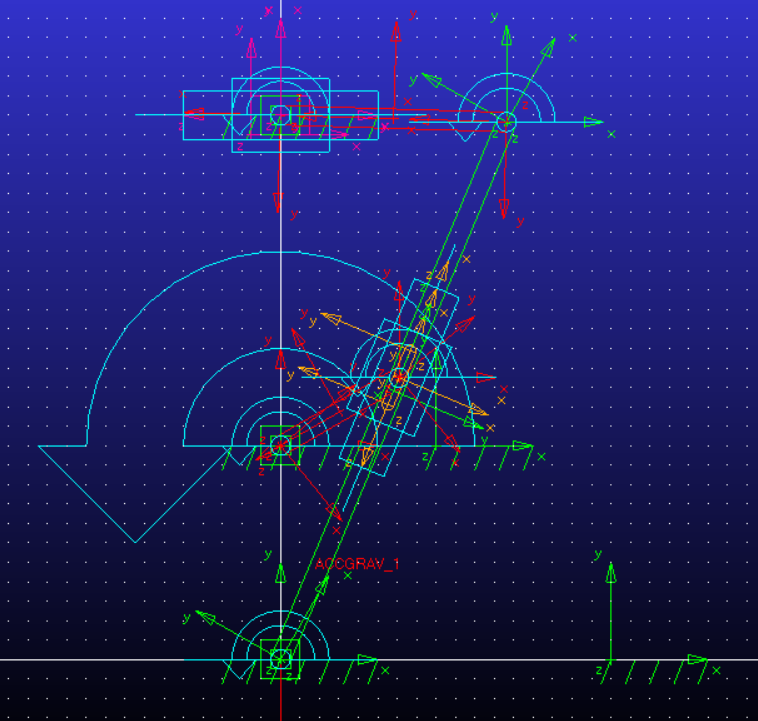

# Quick Return Mechanism Analysis

A Machine Dynamics project by **Pouya Asghari**, analyzing a quick-return mechanism and a cam-based alternative using **MATLAB, Adams/View, SAM, and SolidWorks**.



## Objectives

- Analyze member positions, velocities, and accelerations over two crank revolutions.
- Calculate joint forces and required input torque under an applied load.
- Develop a cam profile intended to reproduce the follower motion.
- Compare analytical MATLAB outputs with Adams simulations and visualize the assembly in SolidWorks.

## Model and methods

The MATLAB analysis uses vector-loop closure equations, a Newton–Raphson position solver, Jacobian-based derivatives, and a fourteen-unknown dynamic force system. The source specifies a 200 N load, input speed of 1 rad/s, zero input angular acceleration, and 2000 angular samples over two revolutions. Link masses and inertias are taken from Adams under the source's density assumption of 1 kg/m³.

Cam coordinates are described as being generated through an Excel workflow and transferred to Adams. The report includes screenshots of that procedure; the spreadsheet and CSV files are not separately supplied.

## Findings and limitations

The report compares link angles, variable vector length, angular velocities, accelerations, forces, and input torque. It explicitly notes a disagreement in member 5's angular velocity between MATLAB and Adams. This mismatch remains unresolved. The original source code also contains expressions requiring review before reuse; see the English report's editorial appendix.

The source describes force and torque peaks around a particular return-motion phase and presents cam and mechanism animations. These are software study results, not experimentally validated performance or a quantified optimization result. No native simulation rerun was performed while preparing this repository.

## Files

| Path | Contents |
| --- | --- |
| [report/main.pdf](report/main.pdf) | English translation with equations, comparison figures, code, and editorial notes |
| [report/main.tex](report/main.tex) | Editable LaTeX source |
| `report/figures/` | Original report images |
| [report/BUILD.md](report/BUILD.md) | Local and Overleaf instructions |
| [matlab/QuickReturnAnalysis.mlx](matlab/QuickReturnAnalysis.mlx) | Original MATLAB Live Script |
| [matlab/quick_return_extracted.m](matlab/quick_return_extracted.m) | Code extracted from Live Script blocks, with text headings converted to comments |
| [matlab/report_listing.m](matlab/report_listing.m) | Separate historical code listing extracted from the Word report |
| `matlab/Workspcae.mat` | Original saved workspace; original filename retained |
| [adams/native_models.zip](adams/native_models.zip) | Unchanged `QuickReturn.bin` and `CAM.bin`, compressed for browser upload |
| `adams/` | Original screenshot and smaller demonstration videos |
| `sam/QuickReturn.sam` | Original SAM project |
| `solidworks/Assem.SLDASM` | Original assembly; keep its referenced parts in the same directory |
| `solidworks/` | Part files, design screenshots, and assembly animation |
| [docs/RUNNING.md](docs/RUNNING.md) | Software requirements and reproduction checks |

The approximately 62.4 MiB `MATLAB.video.mp4` remains in the original RAR archive and is excluded from this browser-upload package. It is not required for LaTeX compilation. All other supplied videos are retained. Extract `adams/native_models.zip` before opening the binary models; the original CAM file itself exceeds GitHub's browser-upload per-file limit.

## Requirements and use

- MATLAB with Symbolic Math Toolbox for the supplied symbolic expressions, Jacobians, and force-system construction. A compatible release is needed for local functions within script sections. Start with the original Live Script.
- A compatible Adams/View installation for the binary mechanism and cam models. One source recording is labeled Adams 2020; exact compatibility was not tested.
- A compatible SAM installation for the `.sam` file.
- SolidWorks for the assembly and part files; the source does not specify a release.

Open a working copy of the native model in the relevant application. Preserve all SolidWorks part references. Review source equations, speed conventions, force signs, and mass units before comparing new runs. The `.m` exports are readable source versions, not tested corrected implementations. See [the running guide](docs/RUNNING.md).

## Build the report

Upload the complete package ZIP to Overleaf, select `report/main.tex`, and use **pdfLaTeX**. Alternatively, run from the repository root:

```bash
cd report
pdflatex -interaction=nonstopmode -halt-on-error main.tex
pdflatex -interaction=nonstopmode -halt-on-error main.tex
```

The report requires its figure folder and the sibling `matlab/report_listing.m` file. Standard LaTeX packages and Latin Modern fonts are sufficient; no custom fonts or bibliography database are required.

## Academic context

Machine Dynamics, School of Mechanical Engineering, College of Engineering, University of Tehran. Instructor: Dr. Rastgoo. Second semester of academic year 1403–1404; original submission date 1404/03/16 (Iranian calendar).

English translation, LaTeX conversion, repository documentation, and separate editorial notes were prepared with AI assistance. Original native files and figures are preserved. The source's equations and numerical claims are retained with qualification; the MATLAB and commercial simulations were not executed during preparation.

## License

No license has been selected. Add one after deciding the intended reuse permissions. Referenced software and third-party materials retain their own terms.
